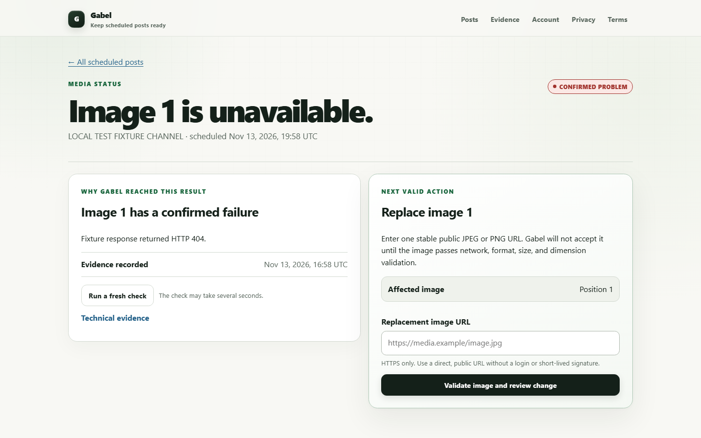

  

<h1 align="center">Gabel</h1>

<strong>Check before it goes live.</strong>

Gabel helps developers, creators, and small publishing teams catch an externally hosted image that has become unavailable after a Buffer API post was scheduled. It turns that fragile gap into a guarded workflow: inspect the evidence, approve one precise replacement, and verify that Buffer preserved the post around it.

Real Gabel interface captured from the application’s browser test. The post and HTTP 404 shown here are explicitly labeled local fixtures—not a live Buffer repair claim.

## How to test

The safest judge path is read-only: open the hosted app, connect a Buffer account you control, refresh the queue, and choose **Check media accessibility** on a scheduled media post. Checking media and preparing a replacement do not edit Buffer; a mutation requires a separate post-specific confirmation.

**[Open the complete judge and developer testing guide →](docs/HOW-TO-TEST.md)**

> Do not test repair on an important post. There is no shared demo account or disposable judge post; stop after the read-only check unless you control a disposable scheduled X image post and explicitly approve the exact edit.

## Detect → Review → Verify

| Step | What happens |
|---|---|
| **Detect** | Gabel retrieves genuine scheduled posts and performs a fresh, bounded check without exposing media URLs in the result. |
| **Review** | For a supported X image post, Gabel validates a direct public JPEG or PNG and shows the affected position, evidence, and fields that must remain unchanged. Nothing is edited yet. |
| **Verify** | After exact typed approval, Gabel refetches before mutation, sends the complete approved asset list, refetches again, and reports success only when protected fields match. |

This is the locked **DETECT → REPAIR → VERIFY** product flow. Review and explicit approval are the safety boundary before repair.

## What Gabel actually does

- Connects to Buffer through OAuth Authorization Code flow with PKCE.
- Retrieves authorized organizations, channels, and cursor-paginated scheduled posts.
- Labels bounded media checks as **CONFIRMED PROBLEM**, **COULD NOT VERIFY**, **UNSUPPORTED FILE**, or **READY**.
- Supports a narrow repair path: JPEG or PNG replacements on scheduled X image posts.
- Requires a fresh confirmed failure, a short-lived review, and an exact one-time confirmation before `editPost`.
- Compares the fresh after-state with the approved assets and protected copy, channel, schedule, status, metadata, tags, and media order.
- Keeps uncertain mutation or verification outcomes ambiguous instead of presenting them as success.

## Live application and source

- **Application:** [gabel-six.vercel.app](https://gabel-six.vercel.app)
- **Workspace:** [gabel-six.vercel.app/workspace](https://gabel-six.vercel.app/workspace)
- **Source:** [github.com/YakiUdoph/Gabel](https://github.com/YakiUdoph/Gabel)
- **Judge guide:** [JUDGE.md](JUDGE.md)

The production deployment was rechecked on November 14, 2026: the current `main` deployment is `READY`, the public alias serves the landing page, and liveness/readiness return HTTP 200. `READY` is deployment evidence, not a compliance certification or proof that a judge can reproduce a repair today.

## Verified Buffer integration and evidence

| Classification | Evidence |
|---|---|
| **Verified live** | OAuth-backed Buffer account, organization, channel, scheduled-post, asset, capability, schema/media-format, and read-only media operations. Production OAuth plus one authentic empty scheduled-queue sync were verified on November 13, 2026. |
| **Verified live once, not currently reproducible** | On November 8, 2026, one authorized disposable X image post completed confirmed HTTP 410 detection, replacement validation, exact approval, one assets-only `editPost`, and a fresh zero-discrepancy preservation comparison. The post was then deleted and the controlled fixture restored under separate approvals. |
| **Automated** | The current local suite passes 82 unit/security tests and 5 SQLite integration tests; the Neon integration is skipped when `DATABASE_URL` is not configured. Mocked Buffer behavior is never counted as live evidence. |
| **Production** | Vercel Functions, durable Neon PostgreSQL, public routes, security headers, OAuth initiation/callback boundaries, and managed persistence have deployment evidence. |
| **Blocked / unknown** | No shared account or disposable post exists for a judge to reproduce the mutation. User demand, failure frequency, willingness to pay, manual assistive-technology results, and qualified legal conclusions remain unverified. |

Buffer’s official documentation confirms the underlying boundary: API media uses direct public URLs and must remain reachable until publication; Buffer may fetch scheduled media hours or days later. It also documents PKCE OAuth, `offline_access`, scheduled-post reads, ordered assets, and `editPost`: [hosting media](https://developers.buffer.com/guides/hosting-media), [authentication](https://developers.buffer.com/guides/authentication), and [API reference](https://developers.buffer.com/reference.html).

See the sanitized [live integration report](docs/BUFFER-LIVE-INTEGRATION-REPORT.md) and [controlled repair plan](docs/CONTROLLED-E2E-REPAIR-TEST-PLAN.md) for the full evidence boundary.

## Tech stack

- Node.js 24 and TypeScript
- Server-rendered HTML and CSS; no client framework
- Buffer GraphQL API and OAuth 2.0 with PKCE
- Vercel Node.js Functions in production
- Neon PostgreSQL in production; SQLite for local/Docker operation
- Node’s built-in test runner and a real Chromium browser harness

## Security and limitations

Buffer credentials stay server-side and are encrypted at rest. Tenant scoping, CSRF protection, single-use edit claims, token-refresh fencing, public-HTTPS media policy, DNS/IP validation, redirect revalidation, bounded response inspection, retention cleanup, account deletion, and fresh before/after verification are implemented and tested within the documented scope.

Gabel does **not** guarantee future media availability, full-file integrity, publication by Buffer, or acceptance by a social platform. Checks inspect at most ten assets and a 64 KiB prefix per response; repair currently supports scheduled X JPEG/PNG images only; there is no background monitoring, automatic repair, bulk edit, or automatic mutation retry. Production compliance remains **FAILED** pending manual accessibility testing, qualified legal review, and remaining operational review—see the [compliance gate](docs/COMPLIANCE-PRIVACY-SECURITY-ACCESSIBILITY-GATE.md).

## Technical documentation

- [How to test Gabel](docs/HOW-TO-TEST.md)
- [Judge evaluation guide](JUDGE.md)
- [Architecture](ARCHITECTURE.md)
- [Buffer live integration report](docs/BUFFER-LIVE-INTEGRATION-REPORT.md)
- [Controlled repair test plan](docs/CONTROLLED-E2E-REPAIR-TEST-PLAN.md)
- [Production deployment evidence and procedure](docs/PRODUCTION-DEPLOYMENT.md)
- [Compliance, privacy, security, and accessibility gate](docs/COMPLIANCE-PRIVACY-SECURITY-ACCESSIBILITY-GATE.md)
- [Accessibility test results](docs/ACCESSIBILITY-TEST-RESULTS.md)
- [Data inventory and retention](docs/DATA-INVENTORY-AND-RETENTION.md)
- [Competitive validation and Serial Winner Score](docs/COMPETITIVE-VALIDATION-AND-SERIAL-WINNER-SCORE.md)
